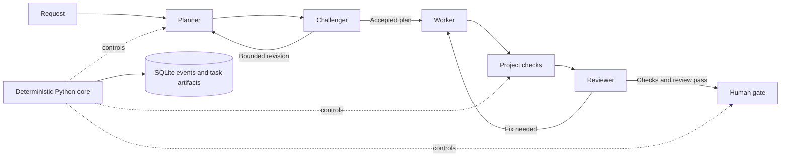

# MARU

**Memory-Aware Relay & Understanding** — a local CLI that turns agent handoffs into an
inspectable development workflow: plan, challenge, implement, test, review, and ask a human.

This **0.2.0 release candidate is a curated snapshot of earlier private development**.
It preserves the existing relay and context/governance extensions. The public snapshot does
not reproduce the private repository's history. License selection is pending owner approval;
this candidate does not grant an open-source license.

## 1. Problem

Using several coding agents often makes the developer the message queue: copy the request,
forward a plan, collect a diff, run checks, and explain the result to a reviewer. When a session
ends, the next agent may lose the reason for a decision or repeat an unsuccessful attempt.

## 2. Why MARU

MARU keeps the workflow's state outside model conversations. Each role returns a structured
artifact; Python controls transitions, checks, retry limits, and approval. The developer can
inspect what happened and what remains blocked without reconstructing a chat transcript.

## 3. Features

- Planner → Challenger → Worker → deterministic checks → Reviewer relay.
- SQLite-backed Arcs, events, and human gates, with numbered execution evidence on disk.
- Project execution lock, request-reuse checks, and approval-aware restart behavior.
- Claude Code and Codex CLI adapters, with bounded execution and configured fallback.
- Role-specific context, incremental review diffs, and invocation/byte/duration telemetry.
- An offline demo and fixture-based tests that require no model credentials.

## 4. Architecture



The diagram shows the normal path; failures pause or enter bounded revision loops.
See [architecture and failure boundaries](docs/ARCHITECTURE.md) for the implementation map.

## 5. Installation

Requirements: **Python 3.12+, Git, and uv**. From this source checkout:

```text
uv sync --locked
uv run maru --help
```

The locked environment includes development tools. The offline path needs neither Claude nor
Codex. MARU is not assumed to be published on PyPI; do not substitute an unrelated package
with the same name. Installation may download dependencies; the demo itself makes no model calls.

## 6. Quick start: offline

```text
uv run python scripts/demo.py
```

The demo creates a temporary Git project and uses deterministic fake adapters with the real
relay, local checks, state store, and approval flow. A synthetic Challenger first rejects the
plan; after resume, the relay replans, writes a greeting helper, and checks it with Python.
The demo automatically approves its synthetic gate. **This automation is demo-only**; real
users inspect and decide their own gates. This demonstrates orchestration, not live model quality.
See the [captured demo walkthrough](docs/DEMO.md) for output and evidence locations.

To retain the generated project, provide a new or empty directory:

```text
uv run python scripts/demo.py --directory demo-output
```

Run the regression suite when developing MARU:

```text
uv run pytest
```

## 7. CLI reference

These are CLI forms, not instructions to run a paid relay during the offline quick start.
In the source checkout, prefix them with `uv run`.

| Command | Purpose |
|---|---|
| `maru init` | Create the local database and constitution; does not generate TOML |
| `maru doctor` | Inspect runtime, executable versions, assets, and check configuration |
| `maru run "Goal" --slug example` | Execute a relay; normally invokes external agent CLIs |
| `maru run --prompt-file request.md --slug example` | Read the request from a file |
| `maru status` / `maru trace example` | Inspect current state / event history |
| `maru cost example` / `maru inbox` | Inspect telemetry / pending human gates |
| `maru approve <gate-id>` / `maru reject <gate-id>` | Resolve a human gate |
| `maru resume example` | Restore a paused Arc's prior state |

**Live Claude trial verified on Windows; each new run still requires your credentials and usage approval.**
One calculator bug was fixed through the real four-role Claude relay and pytest gate; the
result remains at human approval with PENDING_INDEPENDENT_AUDIT because all roles used Claude.
See the [live evidence and reproduction](docs/DEMO.md#live-claude-calculator-trial).
Install MARU into the environment that exposes its CLI, authenticate the selected
provider CLIs, and review their permissions and costs. Work in a trusted target repository with
a committed baseline and meaningful project checks. Keep the request outside the target tree
or commit it before running. `doctor` does not validate authentication and can exit successfully
while reporting missing tools.

After resolving a blocker, `resume` updates state; repeat the original `run` command to restart
planning. An open human gate must be resolved first. A different request requires a new slug.
Approval records `MERGED` as MARU's completion state; it does **not** merge, commit, or push Git.

## 8. Configuration

Create `maru.toml` in the target repository. For a project whose tests use pytest:

```toml
[test_gate]
commands = [["python", "-m", "pytest"]]
```

Checks are argv arrays, executed without a shell. A missing check configuration blocks the
Worker. Use checks that test the requested behavior; a command that always succeeds proves nothing.
Missing roles default to Claude Planner/Worker and Codex Challenger/Reviewer. A role override
specifies both backend and permission:

```toml
[agents.reviewer]
backend = "codex"
permission = "read-only"
fallback = ["claude"]
```

See [maru.toml](maru.toml) for loop, context, and provider policies. Keep the default `.maru`
state paths; some adapter and constitution paths are fixed there. Storage paths cannot escape
the project or target `.git`. Ignore generated `.maru/` state and `tasks/<slug>/` output in the
target repository; they may contain prompts, model output, snapshots, and private local paths.

`MARU_CLAUDE_BIN`, `MARU_CODEX_BIN`, and `MARU_GIT_BIN` override executable paths, not shell
commands. [.env.example](.env.example) is reference material; MARU does not load `.env` automatically.
Credentials remain the provider CLI's responsibility.

## 9. Tests and evidence

```text
uv run ruff check .
uv run mypy src scripts
uv run pytest
uv build
```

Tests cover configuration rejection, gates, agent failures, test failures, restart evidence,
process handling, and temporary external projects. Fake/recorded adapters do not establish
current live-provider compatibility. Exact executed commands, counts, skips, and reused evidence
belong in [the verification report](docs/VERIFICATION_REPORT.md).

## 10. CI

[GitHub Actions](.github/workflows/ci.yml) configures Ubuntu, macOS, and Windows jobs for locked
installation, CLI smoke checks, Ruff, Mypy, package build, and pytest. Actions are pinned to commit
SHAs. A configured matrix is not a passing matrix: consult recorded execution evidence before
claiming platform support. No hosted CI badge or live-model success is implied by this candidate.

## 11. Design choices

| Choice | Reason and tradeoff |
|---|---|
| Plain Python state machine | Keeps control explicit and testable; the relay remains sequential |
| SQLite plus files | Makes state and artifacts locally inspectable; their writes are not one atomic transaction |
| Typed role artifacts | Separates planning, execution, and review; valid JSON still needs semantic checks |
| Deterministic checks plus human gate | Separates executable evidence from model judgment and human authority |
| Role projection and incremental diffs | Reduces repeated context where applicable; no measured cost-saving claim |

These choices focus on developer tooling, diagnosable execution, and boundaries that both humans
and agents can use. See [the portfolio summary](docs/PORTFOLIO_SUMMARY.md) for evidence-backed results.

## 12. Limitations and release status

- Restart replans; exact checkpoint continuation and exactly-once execution are not implemented.
- Interrupted Worker changes can require manual reconciliation before the clean-tree guard allows
  another run. Filesystem evidence and SQLite do not commit atomically.
- Worker guards run after execution; they are not an OS sandbox or a rollback guarantee.
- Same-provider fallback is labelled accordingly. Current adapters do not populate token counts;
  `cost` reports available telemetry, not a billing estimate or benchmark.
- Learning/Bridge agents, memory consolidation, dashboards, and task scheduling are not implemented.
- Local logs are unredacted. Review them before sharing. Publication and license approval remain
  separate from passing tests; see [release readiness](docs/RELEASE_READINESS.md).

## 13. Roadmap

Near-term work is evidence-led: exact checkpoint recovery, stronger execution isolation, and
approved live-provider evaluation with measured context and execution costs. Broader learning and
memory ideas remain research directions, not promises or prerequisites for this CLI release.
