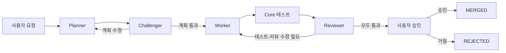

# MARU Orchestrator

MARU는 코딩 에이전트의 계획, 구현, 리뷰를 연결하는 로컬 CLI 도구다. Python Core가 실행 순서를 관리하고, 테스트와 사용자 승인을 거쳐 작업을 완료한다.

이름은 **Memory-Aware Relay & Understanding**의 약자다. 현재 공개 후보는 0.2.0이며, CLI와 실행 기록 관리에 초점을 맞췄다.

## 프로젝트 소개

여러 코딩 에이전트를 함께 쓰면 요청과 계획을 복사하고, 수정 결과를 다음 도구에 전달하는 일이 반복된다. 세션이 끝난 뒤에는 어떤 판단으로 파일을 바꿨는지 다시 찾아야 한다.

MARU는 이 전달 과정을 역할별 JSON 산출물로 연결한다. 작업 상태와 승인 이력은 SQLite에, 프롬프트와 테스트 결과는 파일에 남긴다. 개발자는 `status`, `trace`, `inbox`로 진행 상황과 다음 결정을 확인할 수 있다.

## 주요 기능

- **역할별 실행:** Planner, Challenger, Worker, Reviewer가 계획·검토·구현을 나눠 수행한다. Claude Code와 Codex CLI 어댑터를 제공한다.
- **결정론적 상태 관리:** 상태 전이, 재시도 한도, 테스트 통과 여부를 Python 코드에서 판단한다.
- **실행 기록:** 요청, 역할별 프롬프트, 모델 응답, diff, 테스트 로그와 승인 이력을 보존한다.
- **테스트 게이트:** 프로젝트에 설정한 명령을 Core가 실행하고, 검사 중 파일이 바뀌면 리뷰 전에 중단한다.
- **사용자 승인:** 테스트와 리뷰를 통과한 결과를 승인 또는 거절한다. 열린 승인 게이트가 있으면 재실행을 막는다.
- **실패 처리와 재계획:** 오류를 분류해 작업을 일시정지하고, 원인을 해결한 뒤 저장된 상태에서 다시 계획한다.

## 동작 구조



계획 수정과 코드 수정은 설정된 횟수 안에서 진행한다. 실행 환경이나 권한 때문에 진행할 수 없으면 `PAUSED` 상태로 멈추고 사유를 기록한다. `MERGED`는 MARU의 작업 완료 상태다. Git 커밋·병합·Push는 사용자가 별도로 수행한다.

구현 구조와 실패 경로는 [아키텍처 문서](docs/ARCHITECTURE.md)에 정리했다.

## 설치와 실행

Python 3.12 이상, Git, [uv](https://docs.astral.sh/uv/)가 필요하다.

```sh
git clone https://github.com/hyeonjunni/maru-orchestrator.git
cd maru-orchestrator
uv sync --locked
uv run maru --help
```

이 저장소의 소스나 빌드한 wheel로 설치한다. 설치 과정에서는 Python 의존성을 내려받을 수 있다.

### 먼저 오프라인 데모 실행하기

```sh
uv run python scripts/demo.py
```

데모는 임시 Git 프로젝트와 가짜 에이전트 응답을 사용한다. 계획 거절, 재개, 코드 작성, 실제 Python 검사, 승인 대기와 완료까지 Core의 흐름을 실행한다. 외부 모델 인증과 호출 비용 없이 실행할 수 있다. 데모의 합성 게이트만 자동 승인하며, 실제 작업은 사용자가 결정한다.

생성한 파일을 직접 살펴보려면 새 디렉터리나 빈 디렉터리를 지정한다.

```sh
uv run python scripts/demo.py --directory demo-output
```

### 실제 프로젝트에 연결하기

대상 프로젝트의 Python 환경에 MARU를 설치하고, 사용할 Claude Code·Codex CLI에 각자의 적법한 계정으로 로그인한다. 인증은 제공자 CLI가 담당한다. MARU는 로컬 CLI 프로세스를 실행하며 인증 정보 수집·재판매·중계 기능을 두지 않는다.

먼저 대상 프로젝트의 기준 코드를 Git에 커밋하고, `maru.toml`에 검사 명령을 작성한다. pytest를 사용하는 프로젝트의 최소 설정은 다음과 같다.

```toml
[test_gate]
commands = [["python", "-m", "pytest"]]
```

이때 `python`은 대상 프로젝트의 테스트 의존성이 설치된 실행 파일이어야 한다. 기본 역할은 Claude Planner·Worker, Codex Challenger·Reviewer다. 역할별 제공자와 재시도 한도는 [설정 예시](maru.toml)를 참고한다.

대상 프로젝트에서 실행한다. `run`부터는 외부 모델을 호출하므로 계정 사용량과 권한 설정을 먼저 확인한다.

```sh
maru init
maru doctor
maru run "기존 테스트를 유지하면서 add 함수의 버그를 수정해 줘" --slug fix-add
maru status
maru trace fix-add
maru inbox
```

`init`은 로컬 DB와 기본 헌장을 만든다. `maru.toml`은 사용자가 작성한다. `doctor`는 실행 파일과 설정을 점검하며, 로그인 상태와 실제 모델 연결은 각 제공자 CLI에서 확인한다.

결과를 읽은 뒤 `maru approve <gate-id>` 또는 `maru reject <gate-id>`로 결정한다. 일시정지된 작업은 원인을 해결하고 `maru resume <slug>`를 실행한 다음, 원래 `run` 명령으로 재계획한다. 보호 파일의 변경이 필요한 경우에는 사람이 직접 처리한다.

### 자주 쓰는 명령

| 명령 | 용도 |
|---|---|
| `maru run --prompt-file request.md --slug example` | 파일에서 작업 요청 읽기 |
| `maru status` | 현재 작업 상태 확인 |
| `maru trace <slug>` | 상태 전이와 이벤트 조회 |
| `maru inbox` | 승인 대기 목록 확인 |
| `maru approve <gate-id>` / `maru reject <gate-id>` | 결과 승인·거절 |
| `maru resume <slug>` | 일시정지 전 상태로 복원 |
| `maru cost <slug>` | 역할별 호출 횟수·문맥 크기·실행 시간 조회 |

요청 파일은 대상 작업 트리 밖에 두거나 미리 커밋한다. 생성되는 `.maru/`와 `tasks/<slug>/`에는 프롬프트와 로컬 경로가 포함될 수 있으므로 대상 프로젝트의 Git 제외 목록에 넣고, 공유 전 내용을 확인한다. 기본 `.maru` 저장 경로를 권장한다.

테스트·CI 등 작업 결과를 판정하는 파일은 계획의 `writable_paths`에 정확한 경로가 있어야 수정할 수 있다. 검사 명령은 파일을 바꾸지 않는 모드로 설정한다. 요청이나 필수 입력이 달라지면 새 slug로 실행해 이전 증거를 보존한다.

## 실제 실행 예시

Windows에서 실제 Claude CLI를 네 역할에 연결해 외부 Python 프로젝트의 계산기 버그를 수정했다. 기존 테스트가 실패하는 상태에서 시작했고, Worker가 다음 한 줄을 고친 뒤 Core의 pytest 검사를 통과했다.

```diff
 def add(a: int, b: int) -> int:
-    return a - b
+    return a + b
```

아래는 보존된 실행 기록을 짧게 재구성한 예시 출력이다.

```text
수정 파일       src/calculator.py
수정 전 pytest  1 failed
수정 후 pytest  1 passed
실행 상태       PLANNING → PLAN_REVIEW → IMPLEMENTING
                → TESTING → CODE_REVIEW → HUMAN_APPROVAL
사용자 승인     APPROVED
최종 상태       MERGED
```

사용자가 결과를 승인한 뒤 기존 증거·소스 파일 53개와 이벤트 19개가 보존됐고, 승인·상태 전이 이벤트 2개가 추가됐다. 네 역할 모두 Claude를 사용한 실행이어서 당시 증거 등급인 `PENDING_INDEPENDENT_AUDIT`도 이력에 남아 있다. 이후 별도 Codex 코드 감사를 수행했으며, 저장소 감사와 실제 작업 리뷰는 [검증 보고서](docs/VERIFICATION_REPORT.md)에서 구분한다.

직접 연결 확인을 포함해 Claude 프로세스 5회, CLI 보고 기준 13턴, 약 $1.3293가 기록됐다. 이 금액은 CLI의 회계용 보고 값이다. 실제 추가 청구액과 일반적인 작업 평균은 확인하지 않았다. 한 줄 수정에서는 오케스트레이션 비용이 클 수 있어 문맥과 호출량을 줄이는 일을 후속 과제로 두었다.

실행 설정과 재현 절차는 [데모 문서](docs/DEMO.md#live-claude-calculator-trial)를 참고한다.

## 설계 결정

| 선택 | 이유 |
|---|---|
| SQLite | 별도 서버 없이 작업 상태·이벤트·승인 결정을 저장하고, 상태 변경과 이벤트를 트랜잭션으로 묶는다. |
| Python 상태 머신 | 모델 응답과 실행 권한을 분리하고, 전이 규칙과 실패 조건을 테스트로 확인한다. |
| 프로젝트 단위 잠금 | 여러 작업이 같은 파일을 동시에 바꾸지 않도록 한 프로젝트의 릴레이를 순차 실행한다. |
| 번호별 실행 증거 | 재시작 후에도 이전 프롬프트·산출물·테스트 로그를 비교할 수 있게 한다. |
| Human Approval Gate | 테스트와 모델 리뷰를 확인한 사용자가 최종 결과를 결정한다. |
| 역할별 문맥 | 전체 대화 대신 필요한 계획·diff·검사 결과를 각 역할에 전달한다. |

구체적인 결함 재현과 수정 과정은 [감사 기록](docs/MARU_AUDIT.md), 기술 성과는 [한국어 포트폴리오](docs/PORTFOLIO_SUMMARY.ko.md)에 정리했다.

## 테스트

```sh
uv run pytest -q -ra
uv run ruff check .
uv run mypy src scripts
uv build
```

2026-11-02 Windows 전체 테스트 결과는 **297 통과, 0 실패, 1 건너뜀**이다. 건너뛴 항목은 심볼릭 링크 생성 권한이 필요한 경로 검사다. Ruff·Mypy 검사도 통과했다. 테스트에는 Recorded Adapter, 임시 외부 프로젝트, 승인·거절, 실패·재시작 경로가 포함된다. 패키지 빌드·깨끗한 환경 설치와 실제 Claude 실행 결과는 [검증 보고서](docs/VERIFICATION_REPORT.md)에 기록한다.

[GitHub Actions](https://github.com/hyeonjunni/maru-orchestrator/actions/workflows/ci.yml)에서 Ubuntu·macOS·Windows의 pytest, Ruff, Mypy, 패키지 빌드와 CLI 기본 명령을 검사한다. 커밋별 실행 결과는 링크에서 확인할 수 있다.

## 현재 지원 범위와 알려진 제약

- 실제 Claude 연동은 Windows에서 확인했다. 운영체제별 CI는 외부 모델 호출 없이 테스트와 CLI 기본 동작을 검사한다.
- 중단된 작업은 기록을 바탕으로 재계획한다. 정확한 체크포인트 재개와 한 번만 실행되는 동작의 보장은 후속 과제다.
- Worker 파일 검사는 실행 후에 이뤄진다. 신뢰할 수 있는 프로젝트에서 사용하며, OS 샌드박스와 자동 롤백이 필요한 작업에는 별도 격리가 필요하다.
- 사용자 승인은 로컬 CLI의 결정이다. 같은 OS 계정의 프로세스는 CLI와 저장 파일에 접근할 수 있다. 번호별 기록과 SQLite의 추가 전용 이벤트도 이 신뢰 범위 안에서 보존된다.
- SQLite와 파일 저장은 별도 연산이다. 중단 후 남은 소스 변경은 사용자가 검토·정리해야 할 수 있다.
- 로그는 원문으로 저장된다. `cost`는 현재 어댑터가 제공하는 실행 통계이며, 청구 금액은 제공자에서 확인한다.
- Claude 실제 실행은 한 가지 작은 작업으로 검증했다. 마지막 감사에서 바뀐 계획 스키마는 오프라인 테스트로 확인했으며, 수정 후의 유료 릴레이 재실행은 보류했다.

## Roadmap

다음 개선 범위는 체크포인트 복구, 실행 격리, 문맥·호출 비용 측정, 독립 제공자와 여러 운영체제에서의 실행 검증이다. Learning/Bridge, 메모리 통합, 대시보드와 작업 스케줄러는 향후 검토할 기능이다.

## License

[MIT License](LICENSE). Copyright (c) 2026 hyeonjunni.

이 저장소는 비공개 개발 결과 중 공개할 파일을 추려 별도 Git 이력으로 구성했다. 제3자 의존성의 라이선스와 공개 범위는 [릴리스 준비 문서](docs/RELEASE_READINESS.md)에 기록했다.
