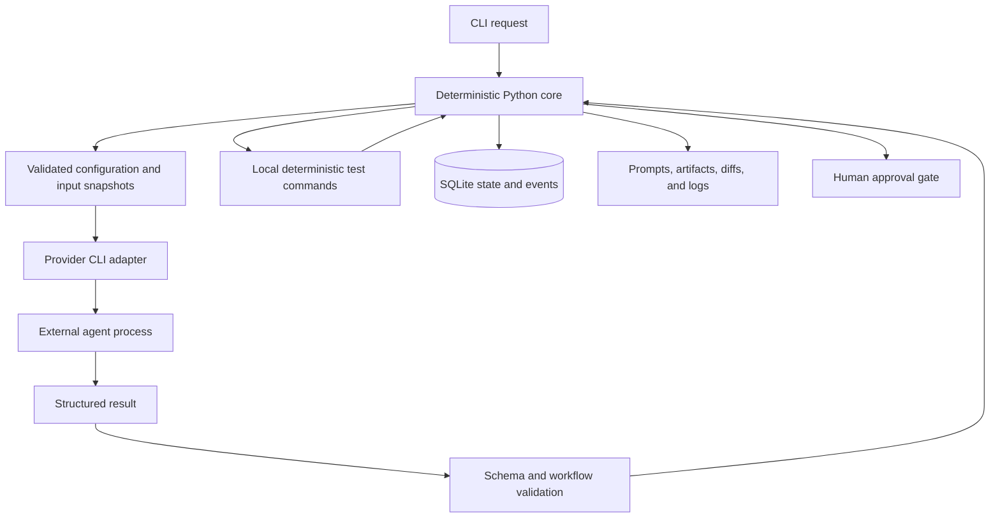

# Architecture

MARU 0.2.0 is a local, sequential agent relay. This curated release candidate preserves the
existing implementation; it does not introduce a new agent framework. The core manages a durable
unit of work called an **Arc**. Model sessions are replaceable execution contexts, not the state store.

## Implementation map

| Module | Responsibility |
|---|---|
| `src/maru/cli/app.py` | Typer commands, diagnostics, inspection, and human decisions |
| `src/maru/core/relay.py` | Ordered execution, preflight, bounded revisions, validation, evidence, and gates |
| `src/maru/core/state_machine.py` | Explicit allowed Arc transitions |
| `src/maru/core/models.py` | Typed requests, results, plans, reviews, Arcs, and gates |
| `src/maru/storage/sqlite.py` | Transactional state/event changes and gate resolution |
| `src/maru/core/testgate.py` | Ordered deterministic subprocess checks |
| `src/maru/core/context.py` | Role projection and context manifests |
| `src/maru/core/inputs.py` | Declared text snapshots and hash verification |
| `src/maru/core/governance.py` | Typed blockers, authority policy, and evidence classification |
| `src/maru/core/telemetry.py` | Available invocation, byte, timing, and fallback measurements |
| `src/maru/agents/adapters/` | Claude/Codex subprocess invocation and output parsing |
| `src/maru/guard/policy.py` | Post-Worker protected-path and grading-file checks |

The CLI and `scripts/proto_harness.py` call the same relay implementation. Packaged prompts and
JSON schemas live in `src/maru/assets/`; project overrides take precedence, and invalid overrides
fail rather than silently falling back.

## Control boundary



The model proposes plans, changes, findings, or blockers. Python chooses the next transition,
enforces configured loop bounds, executes checks, and decides whether to pause or open a gate.
A successful process exit and valid artifact are necessary but insufficient for completion:
configured checks and review must also pass before the completion gate opens.

Production roles receive projected artifacts rather than a shared conversation. No Learning or
Understanding agent is implemented. Keeping future educational conversations separate is a
maintained design boundary, not a claim that the learning product exists.

## State, gates, and restart

The normal state path is:

```text
PLANNING -> PLAN_REVIEW -> IMPLEMENTING -> TESTING -> CODE_REVIEW -> HUMAN_APPROVAL
                |                ^                       |                |
                +-> PLANNING     +---- bounded fixes ----+       MERGED / REJECTED
```

Failures can pause an Arc. Typed blockers distinguish plan-quality problems from missing
capability, exhausted resources, and human authority requirements. Plan revision limits do not
substitute for an authority decision.

SQLite updates Arc state and its transition event in one transaction. Resolving a completion
gate updates the gate and terminal Arc state together. `MERGED` is the historical name for
approved completion; no Git merge occurs. Approving a governance blocker leaves the Arc paused
because granting authority does not perform the work. Rejecting that blocker ends the Arc.
Open gates prevent both direct rerun and resume from bypassing the pending decision.

`maru resume` restores the state preceding the pause. A subsequent `maru run` starts planning
again against the same Arc. **This is restart, not exact checkpoint continuation.** Existing
request content is preserved; conflicting reuse requires a new slug. Source changes left by an
interrupted Worker may need human reconciliation before the clean-tree preflight passes.

An OS-backed project lock excludes competing relay processes using the same state directory.
It covers request creation and relay execution. It is not distributed coordination, and changing
configuration or manipulating runtime files during execution is unsupported.

## Evidence and persistence

Default storage:

```text
.maru/
  maru.db                 # Arcs, events, gates
  constitution.md         # Local authority text
  relay.lock              # Project execution lock
  diff-index              # Private Git index for review snapshots
  runs/                   # Adapter execution evidence

tasks/<slug>/
  request.md
  inputs/                 # Declared text snapshots and manifest
  rendered/               # Numbered prompts, schemas, context manifests
  logs/                   # Adapter result records and deterministic check logs
  artifacts/
    plan.json ...         # Mutable latest views
    human-summary.md      # Current human-facing outcome
    history/              # Numbered role artifacts and review diffs
```

Restart numbering continues from recorded attempts so normal reruns retain previous evidence.
Latest convenience files and the human summary remain mutable. SQLite transactions do not include
filesystem writes: a crash can leave incomplete files or evidence. Retention is not tamper-proof
storage and does not provide automatic rollback.

Explicit external text inputs are snapshotted before planning. Their manifests record hashes,
size, source location, and available Git provenance; hashes are checked again before the Worker.
These records can contain private data and should not be committed or published automatically.

## Context and review

Each role receives selected sections: the Planner sees the request and revision context; the
Challenger sees the proposed plan; the Worker receives the accepted plan and check contract;
the Reviewer receives the implementation report, checks, and diff. A manifest records included,
indexed, and excluded sections with their identity and reason.

Oversized sections use a deterministic index rather than an arbitrary byte cut. An index is not
proof that a model read the full artifact. Later review iterations can receive an incremental
diff while the full diff remains available by path and hash. Git snapshots use a private index,
leaving the user's staging area untouched.

These mechanisms expose context use for inspection. They do not establish measured token,
latency, or monetary savings.

## Adapters, checks, and evidence levels

The default mapping is Claude Planner/Worker and Codex Challenger/Reviewer. TOML can override
roles. Each adapter invokes an external CLI with structured-output options and permission
settings, records output, and handles bounded subprocess execution. Authentication and the
provider's actual permission enforcement belong to that external CLI.

Configured deterministic checks are argv arrays, not shell strings. They run in order and
collect failures; absent checks block the Worker. A passing gate is only as meaningful as the
configured checks. A model's claim that it ran tests does not replace this gate.

Configured fallback can change which provider actually produced an artifact. Evidence labels
use the actual provider identities: same-provider review is not reported as cross-provider
review. When independent review is required, same-provider fallback produces
`PENDING_INDEPENDENT_AUDIT`. Blocked or intentionally unchanged outcomes have separate labels.
Even a cross-provider label describes workflow evidence, not a guarantee of correctness or
statistical independence.

Telemetry records invocations, prompt bytes, durations, and fallbacks. Token counts are optional
in the result model and are not populated by the current adapters. The `cost` command is not a
price calculator. Offline fake adapters validate control flow, not live provider behavior.

## Safety and operational limits

Configuration rejects storage paths outside the project, traversal, and `.git` targets. Use the
default `.maru` directory because adapter and constitution paths are partly fixed. The Worker
preflight rejects genuine dirty source, while MARU-owned bookkeeping is excluded. After a Worker,
cumulative changed paths are checked against protected-file and grading-file rules.

These are workflow guards, not a complete sandbox. The Worker edits the target working tree;
post-execution detection cannot undo writes or prevent every side effect. Child processes inherit
an environment, and logs are unredacted. Use trusted repositories, review diffs, preserve backups,
and avoid publishing runtime evidence without inspection.

Verification scope and platform limits are recorded in [VERIFICATION_REPORT.md](VERIFICATION_REPORT.md).
Publication and ownership decisions are tracked separately in [RELEASE_READINESS.md](RELEASE_READINESS.md).
